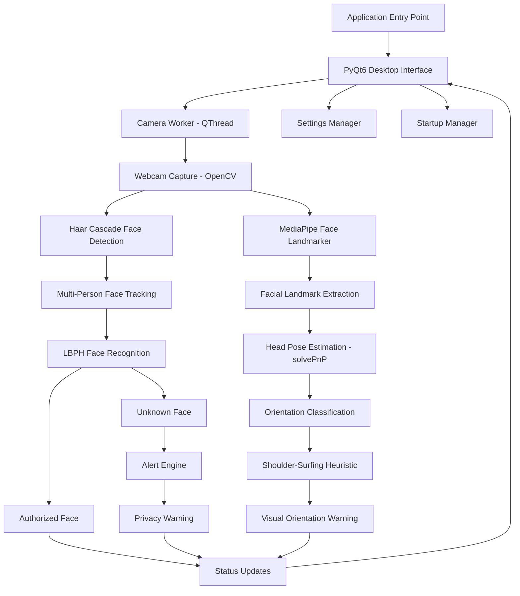
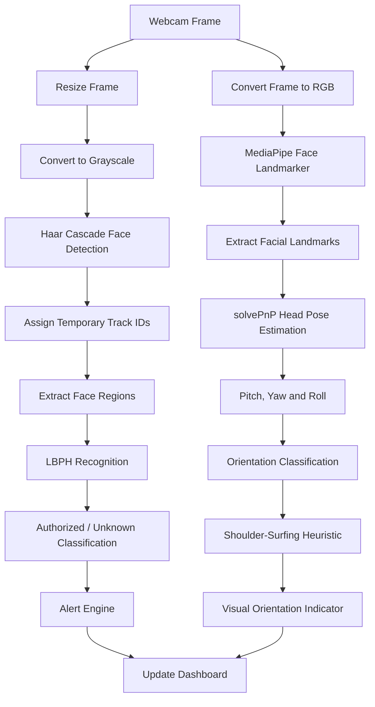

# Privo — Webcam Privacy Guard

**A local, real-time webcam privacy monitoring system built with Python, OpenCV, MediaPipe, and PyQt6.**

Privo is a desktop-based privacy monitoring application designed to help users detect unfamiliar faces appearing in their webcam's field of view and identify potentially suspicious viewing behavior through computer vision.

The application combines face detection, LBPH-based face recognition, temporary multi-person tracking, facial landmark analysis, head-pose estimation, and time-based alert logic into a single desktop interface.

Privo continuously monitors the webcam feed, distinguishes enrolled users from unfamiliar faces, estimates head orientation, and generates visual warnings when configured detection conditions persist.

The application is designed around local webcam processing, with a desktop interface that provides monitoring controls, configurable settings, system tray integration, and Windows startup management.

---

## Table of Contents

- [Overview](#overview)
- [Key Features](#key-features)
- [System Architecture](#system-architecture)
- [Computer Vision Pipeline](#computer-vision-pipeline)
- [Algorithms and Techniques](#algorithms-and-techniques)
- [Technology Stack](#technology-stack)
- [Project Structure](#project-structure)
- [Installation](#installation)
- [Face Enrollment](#face-enrollment)
- [Dataset Verification and Model Training](#dataset-verification-and-model-training)
- [Running Privo](#running-privo)
- [Configuration](#configuration)
- [Privacy and Security](#privacy-and-security)
- [Limitations](#limitations)
- [Future Improvements](#future-improvements)
- [Contributing](#contributing)
- [License](#license)
- [Author](#author)

---

## Overview

Modern laptops and desktop computers frequently operate in environments where screens may be visible to other people.

Whether working in a library, classroom, office, or public space, users may be exposed to unwanted visual observation.

Privo explores a computer-vision-based approach to this problem by monitoring the environment through a webcam.

The system identifies faces, recognizes an enrolled authorized user, tracks additional detected faces across video frames, and estimates the orientation of detected faces.

When an unfamiliar face remains visible for a configurable period, Privo can activate a privacy warning.

It also monitors sustained left or right head orientation as a potential shoulder-surfing indicator.

### Core Objectives

- Detect faces appearing within the webcam's field of view.
- Recognize an enrolled authorized user.
- Identify unfamiliar faces.
- Maintain temporary identities for multiple detected faces across video frames.
- Estimate head orientation using facial landmarks and 3D pose estimation.
- Detect sustained sideways head orientation.
- Generate time-based visual privacy warnings.
- Provide a configurable desktop monitoring interface.
- Support convenient background operation through the system tray.


---

## Key Features

### 1. Real-Time Face Detection

Privo uses OpenCV's Haar Cascade classifier to detect faces from webcam frames.

The detection pipeline includes:

- Live webcam capture.
- Frame resizing for consistent processing.
- Conversion to grayscale.
- Haar Cascade-based face detection.
- Bounding-box extraction.
- Minimum face-size filtering.
- Multi-face detection within a single frame.

The application processes multiple detected faces rather than assuming that only one person will appear in front of the camera.

### 2. Face Recognition Using LBPH

Privo implements Local Binary Patterns Histograms (LBPH) for recognizing the enrolled authorized user.

LBPH is a texture-based face recognition technique that describes local facial texture patterns using binary comparisons between neighboring pixels.

The recognition pipeline:

1. Extracts the detected face region.
2. Resizes the face to a consistent 200 × 200 resolution.
3. Applies histogram equalization.
4. Passes the processed face to the LBPH recognizer.
5. Obtains the predicted label and confidence score.
6. Determines whether the face satisfies the configured recognition threshold.

The current authorization logic uses:

- Label `0` for the enrolled authorized user.
- A configurable confidence threshold.
- Unrecognized or threshold-failing faces as unknown detections.

This provides a lightweight recognition mechanism without requiring a large deep-learning face recognition model.

### 3. Multi-Person Face Tracking

Face detection operates independently on each video frame. Consequently, the same person may receive a different detection position in consecutive frames.

Privo includes a lightweight tracking mechanism to maintain temporary face identities.

The tracking system:

- Calculates face bounding-box centers.
- Associates new detections with existing tracks using spatial proximity.
- Maintains temporary track IDs.
- Tracks missed detections.
- Removes expired tracks after a configurable number of missed frames.

These IDs represent temporary visual tracks, not verified real-world identities.

The tracking mechanism helps maintain continuity between frames and prevents the application from treating every detection as an entirely new person.

### 4. Facial Landmark Detection Using MediaPipe

Privo integrates MediaPipe Face Landmarker for extracting facial landmarks.

The landmarker processes RGB webcam frames and generates facial landmark coordinates.

These landmarks provide geometric information about the face and are subsequently used for head-pose estimation.

The implementation supports processing multiple faces in a frame, with a configured maximum of five faces.

### 5. Head-Pose Estimation

Privo estimates the orientation of a detected face using facial landmarks and OpenCV's `solvePnP()` functionality.

The system uses selected facial landmark positions as 2D image coordinates and corresponding 3D reference points to estimate the head's rotation and translation relative to the camera.

The estimated rotation is decomposed into three angular components:

| Parameter | Description |
|---|---|
| Pitch | Upward or downward head rotation |
| Yaw | Left or right head rotation |
| Roll | Sideways head tilt |

The estimated angles are converted into readable orientation labels.

Possible orientation states include:

- CENTER
- LEFT
- RIGHT
- UP
- DOWN

The application visually displays the estimated direction and corresponding angular measurements.

### 6. Shoulder-Surfing Detection Heuristic

Privo includes a temporal detection mechanism that monitors sustained sideways head orientation.

The system tracks how long a detected face remains oriented towards the left or right.

If the orientation persists beyond the configured threshold, the application flags a potential shoulder-surfing event.

The detection logic uses:

- Head-pose estimation.
- Yaw-based orientation classification.
- Continuous orientation monitoring.
- Time-based thresholds.
- Detection reset when the orientation returns to a non-sideways state.

**Important:** Sustained sideways head orientation is only a behavioral indicator. It does not establish that another person is actually viewing the screen.

### 7. Time-Based Privacy Alerts

Privo includes a dedicated `AlertEngine` that manages when warnings become active and when they disappear.

Instead of generating an alert immediately when an unfamiliar face is detected, the system uses configurable time thresholds.

Two important parameters control this behavior:

| Parameter | Default | Purpose |
|---|---:|---|
| `trigger_delay` | 1.0 second | Time an unfamiliar face must remain detected before activating an alert |
| `clear_delay` | 1.5 seconds | Time without unfamiliar-face detections before clearing an active alert |

This reduces unnecessary warning transitions caused by brief or intermittent detections.

The alert engine uses Python's monotonic clock for elapsed-time calculations.

### 8. Desktop Notification System

Privo provides a desktop-based visual monitoring experience.

The application includes:

- A live webcam preview.
- Monitoring status indicators.
- Face detection and recognition information.
- Visual warning overlays.
- Custom warning popup.
- Start and stop monitoring controls.
- Pause and resume controls.
- Configurable monitoring settings.

The interface is implemented using PyQt6.

### 9. System Tray Integration

Privo supports background operation through the Windows desktop system tray.

Features include:

- Minimize the dashboard to the system tray.
- Restore the dashboard from the tray.
- Continue monitoring when the main window is hidden.
- Access the application through a tray context menu.
- Quit the application explicitly.

Closing the main dashboard hides the interface rather than immediately terminating the monitoring process.

### 10. Windows Startup Management

Privo includes a startup manager that allows the application to launch automatically when the user signs in to Windows.

The interface provides controls to:

- Enable Windows startup.
- Disable Windows startup.
- Check whether automatic startup is enabled.
- Launch the application in a minimized state.

### 11. Configurable Settings

Privo provides a dedicated settings dialog.

The configurable parameters include:

| Setting | Purpose |
|---|---|
| LBPH confidence threshold | Controls face recognition acceptance |
| Trigger delay | Controls how long an unknown face must persist |
| Clear delay | Controls how long the system waits before clearing an alert |
| Camera index | Selects the webcam device |

Settings are managed through a dedicated settings module and can be changed from the desktop interface when monitoring is stopped.

---

## System Architecture

Privo follows a modular desktop architecture in which the user interface, webcam processing, alert logic, settings, and startup management are separated into individual modules.

### Architecture Diagram



### Application Components

**Desktop Interface**

Responsible for displaying the webcam preview, monitoring status, warning notifications, configuration controls, and system tray interactions.

**Camera Worker**

Runs the webcam processing pipeline in a separate Qt thread to avoid blocking the graphical interface.

**Alert Engine**

Controls the activation and clearing of unfamiliar-face warnings using configurable time thresholds.

**Settings Manager**

Loads, validates, and saves application configuration.

**Startup Manager**

Manages the application's Windows login startup behavior.

---

## Computer Vision Pipeline

Privo processes webcam frames through a sequence of computer vision operations.

### Processing Flow




## Algorithms and Techniques

### 1. Haar Cascade Classifier

The Haar Cascade classifier is used for frontal face detection.

It evaluates image features using Haar-like patterns and a cascade of trained classifiers.

The implementation uses OpenCV's built-in frontal-face cascade.

Detection parameters include:

- Scale factor: `1.2`
- Minimum neighbors: `5`
- Minimum face dimensions: `60 × 60`

### 2. Local Binary Patterns Histograms (LBPH)

LBPH is used for lightweight face recognition.

The method converts local image texture into binary patterns by comparing neighboring pixels against a central pixel.

The resulting patterns are summarized using histograms.

The implementation applies histogram equalization and resizes face images to a consistent resolution before recognition.

The recognizer returns a predicted label and confidence value, which are evaluated against the application's authorization threshold.

### 3. Spatial Face Tracking

The tracking module maintains temporary identities across frames.

It calculates the center of each bounding box and associates detections with existing tracks based on spatial distance.

Tracks that remain unmatched for too many frames are removed.

This is a lightweight proximity-based tracker rather than a deep-learning tracking architecture.

### 4. Facial Landmark Geometry

MediaPipe Face Landmarker provides normalized facial landmark coordinates.

These coordinates are converted into pixel positions relative to the webcam frame.

Selected landmarks are used for estimating head orientation.

### 5. Perspective-n-Point Pose Estimation

Privo uses OpenCV's `solvePnP()` for estimating the 3D orientation of a face relative to the camera.

The method uses:

- Selected 2D facial landmark positions.
- Corresponding 3D reference points.
- Camera intrinsic matrix.
- Distortion coefficients.

The estimated rotation vector is converted into a rotation matrix, which is subsequently decomposed to obtain pitch, yaw, and roll.

### 6. Temporal Alert Logic

The alert engine uses elapsed time rather than relying exclusively on individual frame detections.

Its state transitions are based on:

- Whether unfamiliar faces are currently detected.
- The time at which unfamiliar detections began.
- The duration of continuous detection.
- The time at which unfamiliar detections disappeared.
- The configured trigger and clearing delays.

This helps avoid unnecessary alert activation from momentary detection noise.

---

## Technology Stack

| Technology | Purpose |
|---|---|
| Python | Main application language |
| OpenCV | Webcam capture, face detection and image processing |
| OpenCV LBPH | Face recognition |
| MediaPipe | Facial landmark detection |
| NumPy | Numerical operations and coordinate processing |
| PyQt6 | Desktop graphical interface |
| Qt QThread | Background webcam processing |
| Qt Signals and Slots | Communication between processing and interface |
| Windows integration | Automatic startup and system tray operation |

### Dependencies

The project uses the following Python packages:

```text
opencv-contrib-python
numpy
PyQt6
mediapipe==1.2.3
opencv-contrib-python==5.1.0.95
```

The `opencv-contrib-python` package provides the additional OpenCV modules required for LBPH face recognition.

---

## Project Structure

```text
Privo/
│
├── main.py
│
├── camera_worker.py
│
├── alert_engine.py
│
├── enroll.py
│
├── enroll_face.py
│
├── enroll_face_auto.py
│
├── retrain_lbph.py
│
├── verify_face_dataset.py
│
├── settings_manager.py
│
├── startup_manager.py
│
├── requirements.txt
│
├── .gitignore
│
└── README.md
```

### File Descriptions

| File | Responsibility |
|---|---|
| `main.py` | Main PyQt6 application, dashboard, settings dialog, system tray and application lifecycle |
| `camera_worker.py` | Webcam processing, face detection, tracking, recognition, landmark detection and head-pose estimation |
| `alert_engine.py` | Time-based unknown-face alert activation and clearing |
| `enroll.py` | Face enrollment utility |
| `enroll_face.py` | Face enrollment workflow |
| `enroll_face_auto.py` | Automated face enrollment workflow |
| `retrain_lbph.py` | LBPH recognition model retraining |
| `verify_face_dataset.py` | Face dataset verification |
| `settings_manager.py` | Application settings persistence |
| `startup_manager.py` | Windows startup management |
| `requirements.txt` | Python dependencies |
| `.gitignore` | Excludes files and directories that should not be committed |

---

## Installation

### Prerequisites

Before installing Privo, ensure that you have:

- Windows 10 or Windows 11.
- Python installed.
- A working webcam.
- Git installed.
- A working internet connection for installing dependencies and obtaining required model assets.

### Step 1 — Clone the Repository

```bash
git clone https://github.com/SaswataA04/Privo.git
```

Navigate into the project:

```bash
cd Privo
```

### Step 2 — Create a Virtual Environment

```bash
python -m venv .venv
```

### Step 3 — Activate the Environment

For Windows PowerShell:

```powershell
.venv\Scripts\Activate.ps1
```

If PowerShell blocks script execution for the current session:

```powershell
Set-ExecutionPolicy -Scope Process -ExecutionPolicy RemoteSigned
```

Then activate the environment again.

### Step 4 — Install Dependencies

```bash
python -m pip install --upgrade pip
```

Install the project requirements:

```bash
pip install -r requirements.txt
```

The repository's requirements file currently lists both an unpinned and pinned OpenCV contrib dependency. For a reproducible installation, use one compatible OpenCV contrib version rather than installing conflicting versions of the same package.

### Step 5 — Obtain the MediaPipe Face Landmarker Model

Privo requires the MediaPipe Face Landmarker task model.

Download the official `face_landmarker.task` model from the MediaPipe documentation:

https://ai.google.dev/edge/mediapipe/solutions/vision/face_landmarker

Place the downloaded model at the exact path expected by `camera_worker.py`.

The model file is an external runtime asset and should be obtained separately if it is not included in the repository.

### Step 6 — Verify the Installation

Check the installed libraries:

```bash
python -c "import cv2, mediapipe, numpy; from PyQt6.QtWidgets import QApplication; print('OpenCV:', cv2.__version__); print('MediaPipe:', mediapipe.__version__); print('NumPy:', numpy.__version__); print('PyQt6: OK')"
```

Verify LBPH availability:

```bash
python -c "import cv2; print('LBPH available:', hasattr(cv2, 'face') and hasattr(cv2.face, 'LBPHFaceRecognizer_create'))"
```

---

## Face Enrollment

Privo uses an enrolled face dataset to establish the authorized user's recognition profile.

The enrollment utilities are included in the repository.

The general enrollment workflow is:

1. Run the appropriate enrollment utility.
2. Capture facial samples using the webcam.
3. Ensure that the samples contain usable frontal-face images.
4. Save the samples in the dataset structure expected by the training scripts.
5. Verify the dataset before retraining the recognition model.

Good enrollment data should contain:

- Multiple facial samples.
- Consistent face framing.
- Adequate lighting.
- Minimal motion blur.
- Sufficient variation in natural facial appearance.

The enrollment and training utilities should be used together with the dataset verification script to ensure that the recognition model is trained using the intended samples.

---

## Dataset Verification and Model Training

Privo separates dataset preparation, verification, and model retraining into dedicated scripts.

### Verify the Face Dataset

```bash
python verify_face_dataset.py
```

This utility checks the face dataset before retraining.

### Retrain the LBPH Model

```bash
python retrain_lbph.py
```

The retraining script generates the recognition model consumed by the camera-processing pipeline.

The trained model and dataset are runtime assets. Keep them in the expected local directory structure and do not commit personal face samples or trained identity data to a public repository.

---

## Running Privo

Once the dependencies, face dataset, trained recognition model, and MediaPipe model are prepared, start the application:

```bash
python main.py
```

The desktop interface should open and allow you to control webcam monitoring.

### Application Workflow

1. Launch Privo.
2. Open the monitoring dashboard.
3. Select the appropriate webcam if required.
4. Start monitoring.
5. Observe the live webcam preview.
6. Allow the application to identify the enrolled user and unfamiliar faces.
7. Observe head-orientation information.
8. Review visual warnings when detection conditions persist.
9. Pause or stop monitoring when required.

The application can also be launched in a minimized state:

```bash
python main.py --minimized
```

This mode is intended for startup integration.

---

## Configuration

Privo provides configurable parameters through its settings dialog.

### Face Recognition Threshold

The LBPH confidence threshold determines whether a predicted face is accepted as the authorized user.

The current application exposes a range of 10–150.

Higher thresholds make recognition more permissive and can increase false acceptance.

### Alert Trigger Delay

Controls how long an unfamiliar face must remain detected before an alert becomes active.

Default:

```python
trigger_delay = 1.0
```

### Alert Clear Delay

Controls how long unfamiliar-face detections must remain absent before an active alert is cleared.

Default:

```python
clear_delay = 1.5
```

### Camera Index

Controls which camera device is selected.

Typical values:

```python
camera_index = 0
```

Camera index `0` usually represents the default webcam, while additional indices may correspond to external cameras.

---

## Privacy and Security

Privacy is a central consideration in Privo's design.

The application is structured around local webcam processing and desktop-based monitoring.

### Privacy Considerations

- Webcam access is initiated by the local desktop application.
- Camera frames are processed through the local OpenCV and MediaPipe pipeline.
- Temporary face tracking IDs are used for continuity between frames.
- The tracking IDs are not verified identities.
- Personal face datasets and trained recognition models should remain local.
- No cloud-based face recognition service is required by the documented processing pipeline.

### Important Security Recommendations

Users should:

- Keep personal face datasets out of public repositories.
- Avoid committing trained recognition models containing personal identity data.
- Avoid distributing private webcam captures.
- Restrict access to local application data.
- Review dependencies and update them responsibly.
- Use the application only with appropriate consent.

The application should clearly communicate when webcam monitoring is active.

---


### Face Recognition Limitations

- LBPH performance depends heavily on the quality of enrollment samples.
- Significant changes in lighting can affect recognition.
- Extreme head angles may reduce recognition accuracy.
- Similar facial appearances can produce incorrect predictions.
- LBPH is not equivalent to modern deep-learning identity verification.
- The current implementation is designed around one enrolled authorized identity.

### Face Detection Limitations

- Haar Cascade detection may struggle with unusual angles.
- Partial face occlusion can affect detection.
- Low-resolution webcam feeds can reduce detection quality.
- Poor lighting can cause missed detections.

### Head-Pose Limitations

- Head-pose estimates depend on landmark accuracy.
- Camera calibration currently uses an approximate camera matrix.
- Different webcam hardware may affect the estimated angles.
- Head movement does not necessarily indicate someone looking at a screen.

### Shoulder-Surfing Limitations

The current implementation uses sustained left/right head orientation as a heuristic.

It does not directly identify another person viewing the display.

Consequently, it may generate false positives when a user naturally turns their head.

### Runtime Limitations

- Performance depends on available CPU resources.
- Processing multiple faces increases computational load.
- MediaPipe requires its external task model.
- Camera access may be unavailable when another application exclusively occupies the webcam.
- Windows startup integration is platform-specific.

Privo should be considered a privacy-awareness prototype rather than a certified security product.

---

## Future Improvements

Potential directions for expanding Privo include:

### Computer Vision Improvements

- [ ] Replace Haar Cascade detection with a modern deep-learning face detector.
- [ ] Explore embedding-based face recognition.
- [ ] Improve recognition under different lighting conditions.
- [ ] Introduce confidence calibration.
- [ ] Improve multi-person tracking with a dedicated tracking algorithm.
- [ ] Add temporal smoothing to head-pose estimates.
- [ ] Improve camera calibration.

### Privacy Monitoring

- [ ] Add screen-lock integration when an unfamiliar person is detected.
- [ ] Add optional privacy-mode activation.
- [ ] Introduce configurable warning levels.
- [ ] Add more robust multi-person proximity analysis.
- [ ] Improve false-positive reduction.
- [ ] Add configurable monitoring profiles.

### Application Improvements

- [ ] Add a polished first-run setup wizard.
- [ ] Improve camera-device discovery.
- [ ] Add a dedicated model and dataset management interface.
- [ ] Add monitoring session statistics.
- [ ] Add diagnostic logging with privacy controls.
- [ ] Package the application as a standalone Windows executable.
- [ ] Improve accessibility and interface responsiveness.

### Advanced Research Directions

- [ ] Integrate gaze estimation.
- [ ] Explore face orientation and eye-gaze fusion.
- [ ] Investigate real-time screen privacy automation.
- [ ] Explore lightweight on-device inference optimization.
- [ ] Evaluate alternative face recognition architectures.

---

## Contributing

Contributions, suggestions, bug reports, and improvements are welcome.

To contribute:

1. Fork the repository.
2. Create a new feature branch.

```bash
git checkout -b feature/your-feature-name
```

3. Implement your changes.
4. Test the application locally.
5. Commit your changes.

```bash
git commit -m "Add: feature description"
```

6. Push your branch.

```bash
git push origin feature/your-feature-name
```

7. Open a Pull Request.

When contributing, avoid including personal face datasets, webcam recordings, private model files, or sensitive configuration data.

---

## License

No license has currently been specified in the repository.

Until a license is added, reuse, modification, and redistribution of the source code are not automatically granted.

---

## Author

**Created by Saswata Acharya**

Computer Science and Engineering  
Artificial Intelligence and Machine Learning

GitHub: [@SaswataA04](https://github.com/SaswataA04)

Project Repository: [Privo](https://github.com/SaswataA04/Privo)

---

## Project Summary

Privo explores the application of computer vision to everyday desktop privacy.

By combining face detection, LBPH recognition, temporary multi-person tracking, facial landmark analysis, head-pose estimation, and temporal alert logic, the project demonstrates how multiple computer vision techniques can be integrated into a local desktop monitoring application.

The primary objective is to investigate practical, on-device privacy monitoring through a modular Python architecture.

**Privo — Local Computer Vision for Desktop Privacy Awareness.**
